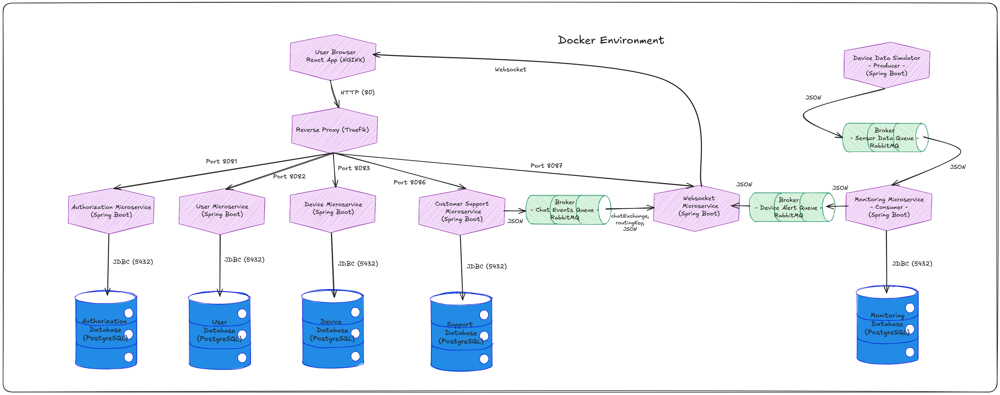

# Energy Management Platform: Microservices

A distributed energy-monitoring system built with **Spring Boot microservices**, **RabbitMQ**, **WebSockets** and a **React** frontend, all deployed with Docker Compose behind a Traefik reverse proxy. It was developed in three stages for the Distributed Systems course at the Technical University of Cluj-Napoca.

Administrators manage users and smart energy devices. Clients see their devices and get **real-time alerts** when a device exceeds its maximum consumption, and can talk to support through a chat.



## Architecture

| Service | Responsibility |
|---|---|
| **Auth** (`/auth`) | Registration, login and JWT issuing (roles `ADMIN` and `USER`), token validation endpoint |
| **User** (`/api/users`) | User CRUD |
| **Device** (`/api/devices`) | Device CRUD, assigning and unassigning devices to users, listing a user's devices |
| **Producer** | Simulates a smart meter: publishes a random measurement every 5 seconds to the `sensor.data.queue` RabbitMQ queue |
| **Consumer / Monitoring** | Consumes the measurements, stores consumption per device, and compares it with the device's `maxConsValue` (fetched from the Device service). When it is exceeded it publishes an alert to RabbitMQ. |
| **WebSocket** (`/ws`) | Consumes alert and chat events from RabbitMQ and pushes them to the right user over STOMP/SockJS (JWT-authenticated) |
| **Customer Support** (`/support`) | Chat between users and admins. A **rule-based chatbot** answers common questions automatically; unanswered messages go to the admin. Messages are persisted. |
| **Frontend** | React 19 + Vite app served by Nginx. Separate admin dashboard and client dashboard, protected routes by role, live alert notifications and chat widgets. |
| **Traefik** | Reverse proxy and single entry point on port 80 |

Each service has its own PostgreSQL database (`user-db`, `device-db`, `auth-db`, `monitoring-db`, `support-db`), and the services communicate through REST (synchronous calls) and RabbitMQ (asynchronous events).

### Message flow

```
Producer ──▶ sensor.data.queue ──▶ Consumer ──▶ DB
                                       │ (limit exceeded)
                                       ▼
                         device-alert-queue ──▶ WebSocket service ──▶ browser
Support chat ──▶ chat.events.ws queue ──────────▶ WebSocket service ──▶ browser
```

## Tech stack

Java 22, Spring Boot 3.3 (Web, Data JPA, Security, AMQP, WebSocket), PostgreSQL 15, RabbitMQ 3, JWT, Docker and Docker Compose, Traefik 3.6, React 19, Vite, Axios, STOMP.js, SockJS.

## Run

Requirements: Docker with the Compose plugin. Everything is built inside Docker, so you do not need Java or Node installed. The first build takes a few minutes.

```bash
cp .env.example .env        # then set JWT_SECRET (see the comment in the file)
docker compose up --build
```

Then open:

- http://localhost: the web application
- http://localhost:15672: RabbitMQ management (guest / guest)
- http://localhost:8080: Traefik dashboard

### Try the real-time alerts

1. Register an `ADMIN` account and a `USER` account in the web app (choose the role in the registration form).
2. As the admin, create a device with a low maximum consumption (e.g. `10`) and assign it to the user. Copy the device's ID.
3. The simulator reports for the device set in `DEVICE_ID`, so restart it with the copied ID:

   ```bash
   DEVICE_ID=<device id> docker compose up -d producer-service
   ```

4. Log in as the user. Within a few seconds the dashboard shows alerts as the device exceeds its limit.

> The values in `.env.example` and the database password default (`postgres`) are for local development only. Use your own secrets for anything deployed.

## Repository layout

```
Auth_Microservice/              JWT authentication
User_Microservice/              user management
Device_Microservice/            device management
Producer_Microservice/          measurement simulator
Consumer_Microservice/          measurement processing and alerts
WebSocket_Microservice/         real-time push
Customer_Service_Microservice/  chat and chatbot
project-frontend/               React app
compose.yaml                    full stack
docs/                           deployment diagrams for each stage
```
